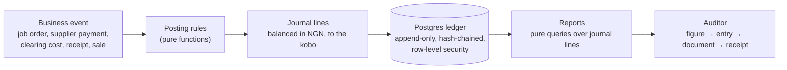
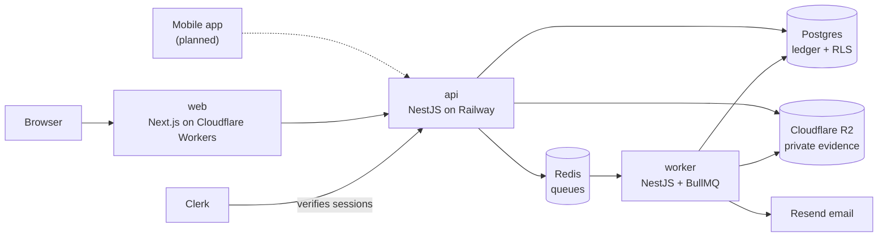

# FinBook

**Audit-ready bookkeeping for vehicle importers.**

FinBook is a multi-tenant accounting platform built for businesses that buy vehicles abroad, clear them through Nigerian ports and sell them at home. It records what actually happens in the trade, a supplier paid in RMB, a container's port charges shared across five cars, a customer's deposit, and turns each event into a double-entry ledger that an auditor can trace from any figure back to the receipt behind it.

It is built and run by an accounting consultancy for its client businesses. Each client sees only its own books; the firm's accountants work across the clients assigned to them.

> FinBook is under active development. It is not yet in production use.

---

## Why FinBook exists

Vehicle importers usually keep their books in spreadsheets. Our first client's workbook is typical, and reviewing it showed the same problems again and again:

- **Profit that isn't profit.** A car bought at one exchange rate and sold at another shows the currency gap as trading margin. On one car, about two-thirds of the reported "margin" was really the naira weakening.
- **Shared costs that don't add up.** A port charge split three ways leaves fractions of a kobo that never return to the amount actually paid.
- **No trail.** Rows have no numbers, no dates, no receipts and no approvals, and any cell can be overwritten without a trace.
- **The wrong revenue.** When the business buys a car *for* a customer, the car isn't its inventory and the full price isn't its revenue. Its revenue is its cut. Spreadsheets rarely make that distinction.

General-purpose accounting software doesn't know what a container, a VIN, a landing charge or a quote-day rate is. FinBook is designed around them.

## What it does

- **Costs every car individually by VIN.** Each car carries its own price, China-side extras, customs levies and its share of container costs, so its profit is its own, never an average.
- **Splits shared costs exactly.** Container charges are allocated in kobo, with any remainder placed on the first car, so allocations always add up to the amount paid.
- **Treats foreign currency honestly.** Every foreign amount stores the rate actually paid and the evidence for it. Foreign cash is costed as a weighted-average pool. Exchange gains and losses are reported on their own lines, never hidden inside margin.
- **Knows when it is an agent and when it is a principal.** Each job is set as customer-funded (the business earns its cut) or business-funded (the car is inventory and the sale is gross revenue), following IFRS 15.
- **Works out the cut instead of letting anyone type it.** Revenue is the accepted quote minus the actual cost, split into car markup and clearing margin, and every job needs the customer's accepted quote on file.
- **Keeps the evidence.** Receipts, customs papers and bills of lading are stored privately and can never be replaced or deleted, only superseded.
- **Closes the month properly.** Bank reconciliation, foreign-currency revaluation, review, then a period lock that no later entry can get past.
- **Delivers reports.** Profit and loss, balance sheet, trial balance, stock on hand, per-car profitability, ageing and an FX summary, as on-screen reports and signed-off PDF packs.
- **Backs up each client separately.** A nightly, encrypted bundle per client that is both an off-site backup and a complete, open-format export of their books.

## How it works

Nobody types journal lines. People record business events, and the system posts them.



Every balance and every report figure is calculated from journal lines. Nothing else in the system stores a balance, so any number on screen can be clicked down to the entries and receipts behind it.

## Principles

These are rules, not preferences. Work that breaks one is wrong, however good it looks.

1. **Money is exact.** Amounts are integers in the smallest unit (kobo, fen, cents) with a currency code. Floating-point numbers never touch money, and the build fails if they do.
2. **The database enforces the ledger.** Postgres itself refuses an entry that doesn't balance, an entry in a locked period, or any change to a posted entry. A bug in the application can't get around it.
3. **History is never rewritten.** A mistake is corrected with a reversal and a new entry. Every posted entry is hash-chained, so tampering with history is detectable.
4. **Each client's data is isolated in the database.** Row-level security means a query can only ever see one client's rows, even if the application gets something wrong.
5. **Rates are facts, not guesses.** A live exchange rate only pre-fills a form; the person entering it confirms it or replaces it with the rate on the receipt.
6. **Every write is audited.** Who changed what, when, and what it looked like before and after.
7. **The API owns the rules.** The web app is just a client, and so will the mobile app be. No business rule lives only in a user interface.

## Architecture



| Part | Role |
| --- | --- |
| `apps/web` | The interface for firm staff and clients. Holds no business logic and has no database access. |
| `apps/api` | Authentication, tenancy, validation and every ledger write, each in one transaction. |
| `apps/worker` | Slow work: PDF reports, email, exchange-rate snapshots, backups and nightly exception reports. |
| `packages/money` | Exact money and FX arithmetic: integer amounts, decimal-string rates, half-up rounding, exact allocation. |
| `packages/db` | Schema, forward-only migrations, row-level security and the database-enforced ledger rules. |
| `packages/ledger` | Posting rules that turn business events into balanced journal lines: customer receipts, currency purchases, supplier payments from the FX pool, container costs and job completion. |
| `packages/contracts` | Shared request and response schemas, the source of the OpenAPI spec. *(planned)* |
| `packages/reports` | Report queries and PDF templates. *(planned)* |
| `packages/ui` | Design tokens and shared components, also exported for the mobile app. *(planned)* |

## Built with

TypeScript throughout, in a pnpm and Turborepo monorepo.

- **Frontend:** Next.js and React on Cloudflare Workers (via vinext), shadcn/ui on Tailwind
- **Backend:** NestJS, BullMQ, Drizzle ORM
- **Data:** PostgreSQL 18, Redis, Cloudflare R2
- **Services:** Clerk (authentication and organisations), Resend (email), Sentry (error monitoring)
- **Hosting:** Railway (API, worker, Postgres, Redis) and Cloudflare (web, storage)

## Standards it follows

FinBook is designed to support these standards. Where a treatment needs professional judgement, a qualified accountant confirms it for each client before go-live.

- **Double-entry bookkeeping**, with every entry balanced in the functional currency (NGN)
- **IFRS 15** (revenue from contracts with customers) for the agent-versus-principal decision on each job
- **IAS 21** (effects of changes in foreign exchange rates) for foreign-currency transactions and month-end revaluation, with both management and statutory treatments available as a report setting
- **Nigeria Data Protection Act 2023** for how client data is stored, processed and protected
- **WCAG AA** accessibility for the interface, usable down to a 360 px phone screen

FinBook produces management accounts and compiled financial statements. It does not replace a statutory audit, which must be signed by an independent auditor licensed in Nigeria. Auditors get read-only, time-limited, fully logged access instead.

## Getting started

You need **Node.js 24+**, **pnpm 12** and **Docker** (for the database tests).

```bash
pnpm install
pnpm lint && pnpm typecheck
pnpm test                 # unit tests
pnpm test:integration     # ledger tests against PostgreSQL 18 in Docker
pnpm build
```

To run the apps locally, see the commands in each app's `package.json`. The worker needs Redis (`docker run -p 6379:6379 redis:8-alpine`). Configuration comes from environment variables only. Never commit a `.env` file.

## Documentation

| Document | What it covers |
| --- | --- |
| [`docs/spec/build-spec.md`](docs/spec/build-spec.md) | The full product and technical specification (source of truth) |
| [`docs/spec/emms-ledger-review.md`](docs/spec/emms-ledger-review.md) | The review of our first client's workbook that shaped the design |
| [`docs/decisions/`](docs/decisions/) | Architecture decision records, one per non-obvious choice |
| [`docs/deploy.md`](docs/deploy.md) | Infrastructure and deployment |
| [`docs/PROGRESS.md`](docs/PROGRESS.md) | Where the build is and what comes next |
| [`CLAUDE.md`](CLAUDE.md) | Engineering rules for everyone working in this repository, people and AI agents alike |

## Contributing

FinBook is built in phases, and each phase is finished only when its acceptance test passes. Before you start, read `docs/PROGRESS.md` for the current phase and the engineering rules in `CLAUDE.md`. Every push runs lint, type checks, unit and integration tests and a build through the pre-push gate (`.githooks/pre-push`; enable it with `git config core.hooksPath .githooks`), and changes to money, the ledger, reports or permissions get an independent review.

## License

This is a private, proprietary codebase. No open-source licence is granted, and the code may not be copied, used or distributed without the owner's written permission.
