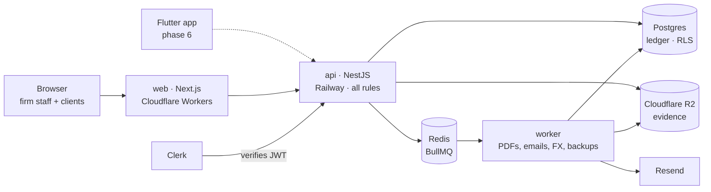

# Vehicle Bookkeeping Platform — Build Spec

Source of truth exported from the Claude Doc on 2026-11-14. Edit the doc, then re-export; do not hand-edit this file.

## Overview

We are building a custom, always-online bookkeeping platform for businesses that import, export and sell motor vehicles. Our consultancy runs it for 20–100 client businesses. Clients enter their own records or we enter them on their behalf. Every balance comes from a double-entry ledger, and each car is costed individually by VIN.

This revision is based on the first client's workbook (EMM's Shop). Cars are bought in China in RMB, cleared at Apapa in shared containers, trucked to Abuja, and sold in naira. Each job is one of two kinds: a full car purchase, or a clearing-only job on a car the customer already owns. The ledger review tab lists what the workbook gets wrong today, and each rule below closes one of those gaps.

Workbook findings and open questions: [emms-ledger-review.md](./emms-ledger-review.md)

**Who uses it**

- **Firm staff** (our accountants): onboard clients, post and review entries, close months, issue reports.
- **Client users** (business owners and their staff): record purchases, costs and sales, view their dashboards, request reports.

**Decisions locked in**

| Area | Decision |
| --- | --- |
| Connectivity | Always online. No offline sync on financial records. |
| Scale target | 20–100 client businesses in year one |
| Repo | One monorepo: Next.js web app, NestJS API, shared packages |
| Auth | Clerk, with Organizations as the tenant boundary |
| Email | Resend for transactional email and report delivery |
| Hosting | Frontend on Cloudflare. API, worker, Postgres and Redis on Railway. |
| Books currency | NGN is the functional currency. Foreign amounts are kept alongside: RMB for cars bought in China, USD where it's used. |
| FX rule | Every foreign-currency transaction stores the actual rate paid. A live rate is only a suggestion. |
| Base code | Built from scratch. No accounting app is forked. |

## Architecture

The frontend is a thin Next.js app on Cloudflare Workers that only ever calls the NestJS API on Railway. The API owns the database, the ledger and every business rule. A separate worker process on Railway handles slow jobs: PDFs, emails, scheduled reports and FX snapshots.



The browser and, later, the Flutter app talk only to the API. The worker reads the same Postgres database and takes its jobs from Redis.

**Monorepo layout** (pnpm workspaces + Turborepo)

```
apps/
  web/        Next.js app → Cloudflare Workers
  api/        NestJS HTTP API → Railway service
  worker/     NestJS standalone app running BullMQ consumers → Railway service
packages/
  money/      Integer money + FX maths, rounding rules (no deps, 100% tested)
  ledger/     Posting rules: vehicle events → balanced journal lines
  contracts/  Zod schemas shared by web and api (request/response types)
  db/         Prisma or Drizzle schema, migrations, seed chart of accounts
  reports/    Report queries + PDF templates
  ui/         Shared design-system components
```

**Services and responsibilities**

| Service | Runs on | Responsibility |
| --- | --- | --- |
| web | Cloudflare Workers | UI, Clerk session, calls the API with the Clerk token. No direct database access. |
| api | Railway | Verifies Clerk JWTs, enforces tenant and role, validates input, writes the ledger in transactions. |
| worker | Railway | BullMQ jobs: PDF render, report emails via Resend, month-end reminders, FX rate snapshot. |
| Postgres | Railway | Single database, row-level security per tenant, daily backups plus point-in-time restore. |
| Redis | Railway | BullMQ queues, rate limiting, short-lived caches. Never the source of truth. |
| Object storage | Cloudflare R2 | Receipts, customs documents, generated PDFs. Private, served by signed URLs. |

**Cloudflare notes**

- Cloudflare now recommends vinext over the OpenNext adapter for new Next.js apps on Workers ([Cloudflare docs](https://developers.cloudflare.com/workers/framework-guides/web-apps/opennext/)). Run its compatibility check in phase 0 and fall back to OpenNext if anything we need breaks.
- Node.js middleware from Next.js 15.2 is not supported on the OpenNext adapter yet, so keep middleware to the Clerk check only.
- Because the web app never touches Postgres, Workers' request-scoped connection limits don't affect us.

**Cross-cutting**

- Sentry in web, api and worker, with tenant ID and request ID on every event.
- Structured JSON logs. Every API call gets a request ID that travels into jobs.
- An OpenAPI spec is generated from the NestJS controllers, and the typed client in web is generated from it.
- Pin every library to the latest stable version, checked against official docs when the build starts. Nothing is taken from memory.

## Accounting core

Every balance, report and profit figure is derived from journal lines. Nothing else in the system stores a balance. If a number on screen can't be traced back to journal entries, it's a bug.

**Ledger invariants** (enforced in the database, not only in code)

1. A journal entry has at least two lines, and its debits equal its credits in NGN, to the kobo. A deferred constraint trigger checks this at commit.
2. Amounts are integers in minor units: kobo for NGN, cents for USD. No floats anywhere, in the database or in JavaScript.
3. Posted entries are immutable. Corrections are reversing entries plus new entries, linked by `reverses_entry_id`. No UPDATE or DELETE is granted on posted rows.
4. Every entry belongs to one accounting period. Once a period is locked, new entries dated inside it are refused. The fix goes in the next open period, or a firm admin reopens the period with a logged reason.
5. Every entry records `source_type` and `source_id` (the vehicle event, invoice or payment that created it), `created_by`, and an idempotency key, so a retried request never double-posts.

**Posting flow**

Users never write raw journal lines. They record business events: buy car, pay freight, receive deposit, sell car. The `ledger` package turns each event into balanced lines using fixed posting rules. Firm accountants also get a manual journal screen for adjustments, which requires a memo and goes through review.

**Default chart of accounts** (seeded per client, editable by firm staff)

| Code | Account | Type |
| --- | --- | --- |
| 1000 | Cash – NGN accounts | Asset |
| 1010 | Cash – foreign currency accounts (RMB, USD) | Asset |
| 1100 | Trade receivables | Asset |
| 1200 | Vehicle inventory – in transit | Asset |
| 1210 | Vehicle inventory – in yard | Asset |
| 1300 | Advances to shipping/clearing agents | Asset |
| 2000 | Trade payables (suppliers, agents) | Liability |
| 2100 | Customer deposits | Liability |
| 2200 | VAT payable | Liability |
| 3000 | Owner's capital | Equity |
| 3100 | Retained earnings | Equity |
| 4000 | Vehicle sales | Income |
| 5000 | Cost of vehicles sold | Expense |
| 6000–6900 | Operating expenses (rent, salaries, transport, marketing) | Expense |
| 7000 | Realized FX gain/loss | Income/Expense |
| 7100 | Unrealized FX gain/loss | Income/Expense |

The tax accounts (VAT, withholding tax) are placeholders. A Nigerian chartered accountant has to confirm how each client's tax position is treated before go-live.

## Vehicle module

Each car is its own inventory item, identified by VIN and costed by specific identification. Its profit is its sale price minus its own landed cost, never an average. Every cost added to a car moves money into that car's inventory value, until the sale moves the whole value into cost of sales.

**Lifecycle**

Purchased → In transit → At port / clearing → In yard (available) → Reserved (deposit taken) → Sold → Delivered. A car can also be Written off (damage, total loss) or Returned. Exports run the same stages in reverse: bought locally, shipped out, sold abroad. Every state change is an event row with a date, a user and its attached documents.

**Two job types** (from the EMM's Shop job orders)

| Job type | What the customer buys | Revenue | Cost |
| --- | --- | --- | --- |
| Car purchase | A car sourced in China, landed in Abuja | Car selling price (quoted in RMB, invoiced in NGN) plus the landing charge | Car price in RMB plus China-side extras, plus the landed costs |
| Clearing only ("SHIPPING" in the workbook) | Clearing and transport for a car the customer owns | Clearing / landing charge only | Landed costs only. The car is never our inventory. |

Whether we're the principal (revenue is the full price) or an agent (revenue is only our margin) on a car purchase changes reported revenue a great deal. An accountant decides this per client under IFRS 15, and it's saved as a tenant setting.

**EMM's Shop is usually an agent.** It buys each car for a customer, so the car is never EMM's inventory. Each car is still tracked by VIN and costed individually, but as a customer job rather than stock. Customer money for the car is a liability until the job completes. EMM's revenue is the car markup plus the landing charge, less the costs it passes on. Agent tenants get four extra accounts: 1150 Recoverable job costs, 2150 Customer funds held, 4100 Car sourcing commission, 4200 Clearing income.

| Event (agent tenant) | Debit | Credit |
| --- | --- | --- |
| Customer pays for the car (deposit or full) | 1000 Cash NGN | 2150 Customer funds held |
| Pay the China supplier for the customer's car | 1150 Recoverable job costs | 1010 Cash foreign currency |
| Pay clearing, levies and transport | 1150 Recoverable job costs | 1000 Cash NGN / 2000 Payables |
| Job completed and invoiced | 2150 Customer funds held (+ 1100 Receivables for any balance owed) | 1150 Recoverable job costs (actual cost), 4100 Car sourcing commission (RMB markup at the quote rate), 4200 Clearing income (landing charge − actual landed cost) |
| Rate paid differs from the quote-day rate | 7000 Realized FX loss | 7000 Realized FX gain |

The per-car profitability report still shows the full car price and every cost for management. Only the margin lines reach the P&L as revenue. The quote-day rate is locked on the job order, so the FX risk between quote and payment is EMM's, and it's reported separately.

**Funding is set per job, not per tenant.** EMM's only buys a car after the customer has paid, except in certain circumstances. So every job order carries a `funding` field:

| Funding | When | Accounting |
| --- | --- | --- |
| Customer-funded (default) | The customer has paid before EMM's pays the supplier | Agent: the postings above. Revenue is EMM's cut. |
| EMM-funded | EMM's pays the supplier before the customer has paid, or keeps a car a customer abandoned | Principal: the car goes into 1200/1210 inventory, and the sale posts gross revenue and cost of sales |

- Funding is chosen when the job order is created, and a reason is required for EMM-funded. It's locked once the first supplier payment posts. Changing it afterwards means a reversal plus a firm reviewer's approval.
- If a customer abandons a customer-funded job after EMM's has paid the supplier, staff run a "convert to stock" action. It moves the car to inventory at its actual cost and applies the deposit-forfeit or refund terms written on the job order.
- An accountant confirms these rules once for each tenant, because they decide how much revenue the business reports.

**For EMM's Shop, EMM-funded jobs are very rare,** so in v1 they're an exception path, not a module. That means a checkbox on the job order, a required reason, and a firm reviewer's approval before any supplier payment posts. Each one also shows on the monthly exception report. There are no separate stock screens. The inventory accounts and postings still exist, so if EMM-funded buying ever becomes routine, only screens need adding and the ledger doesn't change.

**EMM's cut varies by job, so each one has to be provable.** The cut is EMM's revenue, and an auditor will test it against what the customer agreed to.

- Every job order holds a quote, with the car price in RMB, the quote-day rate and the landing charge, accepted by the customer (a signed PDF or a WhatsApp/email confirmation uploaded). Nothing posts to the job without an accepted quote.
- The cut isn't typed in. The system works it out at completion as quote minus actual cost, in two parts: the car markup (to 4100) and the clearing margin (to 4200).
- An exception report flags any job whose cut is negative, zero, or outside the tenant's usual range, so a firm reviewer looks at it before the month locks. A cut that varies is normal. A cut nobody can explain is what an auditor treats as missing revenue.

**Landed cost components**

| Component | Currency | How the workbook assigns it | System default |
| --- | --- | --- | --- |
| Car price (supplier in China) | RMB | Per car | Per car |
| Additional cost (China side) | RMB | Per car | Per car, with a description required |
| IDEC bill | NGN | Per car, amounts differ | Per car |
| NCS FOB levy | NGN | Per car, amounts differ | Per car |
| Form M | NGN | Split equally across the container | Equal split, editable |
| PAAR | NGN | Split equally across the container | Equal split, editable |
| ETLS levy | NGN | Split equally across the container | Equal split, editable |
| Shipping company fee | NGN | Split equally across the container | Equal split, editable |
| AMP terminal fee | NGN | Split equally across the container | Equal split, editable |
| CPC agent fee | NGN | Split equally across the container | Equal split, editable |
| CPH extra fee | NGN | Per car, occasional | Per car, receipt required |
| Transport out of Apapa | NGN | Split equally across the container | Equal split, editable |
| Transport to Abuja | NGN | Split equally across the container | Equal split, editable |
| Repairs, labour, boosting | NGN | Cashbook only ("vehicle maintenance") | Per car if before sale, otherwise an expense |
| Travel, data/airtime, salaries | NGN | P&L expenses | Operating expenses, never capitalized |

Cost types and their default split are kept per tenant, so another importer can rename or add types without code changes.

A cost shared by a container (C4 in the workbook) is paid once and allocated across the container's cars. Allocation is done in kobo, and any remainder goes to the first car, so the allocated amounts always add up exactly to the amount paid. (The workbook's 833,333.333 thirds don't add back to the 2,499,999.99 paid.) Equal split is the default, and staff can switch to split by car value or manual amounts. The split is saved with the entry so reports can be reproduced.

**Per-car profit (NGN)**

```latex
\text{Gross profit} = \text{Sale price}_{NGN} - \sum \text{Capitalized costs}_{NGN}
```

Each capitalized cost is converted at the rate actually paid for it, as the next section explains. The car screen shows both columns, USD and NGN, but profit is reported in NGN. FX gains and losses show on a separate line, so a weaker naira can't be mistaken for trading profit.

**Posting rules (examples)**

| Event | Debit | Credit |
| --- | --- | --- |
| Buy car, paid from a foreign-currency account | 1200 Inventory in transit | 1010 Cash foreign currency |
| Freight invoice received, not yet paid | 1200 Inventory in transit | 2000 Payables |
| Pay clearing agent | 1200 Inventory in transit | 1000 Cash NGN |
| Car arrives in yard | 1210 Inventory in yard | 1200 Inventory in transit |
| Customer deposit | 1000 Cash NGN | 2100 Customer deposits |
| Sale completed | 2100 Deposits + 1100 Receivables / 1000 Cash | 4000 Vehicle sales |
| Same sale, cost side | 5000 Cost of vehicles sold | 1210 Inventory in yard (the car's full landed cost) |

## Currency and FX

The books are kept in NGN. Every foreign-currency transaction (RMB or USD) stores its foreign amount, the rate actually paid, and the NGN result, and none of the three is ever recalculated later. A separate daily reference rate is stored only for month-end revaluation and for comparison.

**Rules**

1. **Rate on every foreign line.** Every non-NGN transaction needs `currency`, `amount_minor`, `rate` and `rate_source` (bank receipt, BDC receipt, agent invoice, or manual with a reason) and a link to the evidence document.
2. **Live rate is a suggestion only.** The form pre-fills the day's rate from a live provider. The user must confirm it or replace it with the rate on the receipt. Neither the code nor the seed data ever holds a hard-coded rate.
3. **Rate precision.** Rates are stored as `NUMERIC(18,6)` and handled as decimal strings, never floats. NGN is rounded half-up to the kobo for each line. If rounding leaves the entry out of balance, the leftover goes on an explicit rounding line.
4. **Foreign cash (RMB, USD) is tracked as a pool.** Each time naira is spent buying RMB or dollars, the pool's NGN cost goes up at that actual rate. When that currency is spent, it comes out at the pool's weighted-average cost. This is what makes the cost of a car "the naira it really took".
5. **Realized FX.** When a foreign-currency payable is settled at a different rate from the one it was booked at, or foreign currency leaves the pool at a different rate from its average cost, the difference posts to 7000 Realized FX.
6. **Unrealized FX at month-end.** Foreign-currency cash, receivables and payables are revalued at the closing reference rate. The difference posts to 7100 Unrealized FX and reverses automatically on the first day of the next period. Inventory isn't revalued, because it's a non-monetary item kept at cost.
7. **Reference rate snapshot.** A daily worker job saves the official reference rate for each currency pair in use (NGN/RMB, NGN/USD), with its source and timestamp. It's used for revaluation and for an "official vs actual" comparison column on reports.

**Selling price conversion.** When a car is priced to the customer in RMB, the naira invoice stores the RMB price, the rate agreed with that customer, and the resulting naira. If that rate differs from the rate the car was bought at, the gap is reported on its own line as FX on sale, not hidden inside the car's margin. In the workbook, rows 3–5 of the sales log convert cost and selling price at different rates. On the BYD Song L (row 5) the rates are 200.14 vs 219.52, so about ₦2.56m of that row's ₦3.86m "margin" comes from the rate gap, not from the RMB markup.

**Known tension, which needs an accountant's sign-off:** under IFRS (IAS 21), a transaction is normally recorded at the spot rate on its date, not at the average cost of the currency used to pay for it. Rule 4 fits management accounts. For statutory statements, the accountant may want inventory at spot rate, with the difference against the pool cost booked as realized FX. Both figures can be worked out from the stored data, so the choice is a report setting and doesn't change the schema.

## Data model

All client data lives in one Postgres database. Every tenant-owned table carries a `tenant_id` and a row-level security policy. IDs are UUIDv7, so they sort by creation time. All money columns are `BIGINT` minor units, paired with a `currency` column.

| Table | Key columns | Notes |
| --- | --- | --- |
| tenants | id, clerk\_org\_id, legal\_name, rc\_number, tin, functional\_currency, fiscal\_year\_start, status | One row per client business |
| memberships | tenant\_id, clerk\_user\_id, role | Mirrors Clerk org membership via webhook |
| accounts | tenant\_id, code, name, type, currency, parent\_id, is\_system | Chart of accounts |
| periods | tenant\_id, starts\_on, ends\_on, status (open / closing / locked), locked\_by, locked\_at | Month periods |
| journal\_entries | tenant\_id, period\_id, entry\_date, memo, source\_type, source\_id, reverses\_entry\_id, idempotency\_key, status, created\_by | Immutable once posted |
| journal\_lines | entry\_id, tenant\_id, account\_id, debit\_ngn, credit\_ngn, currency, amount\_minor, rate, vehicle\_id, counterparty\_id | Exactly one of debit\_ngn or credit\_ngn is greater than 0 |
| vehicles | tenant\_id, vin (unique per tenant), make, model, year, colour, mileage, direction (import / export / local), status, purchase\_date, sold\_date | VIN check-digit validated |
| vehicle\_events | vehicle\_id, type, occurred\_on, from\_status, to\_status, journal\_entry\_id, notes, actor | Lifecycle history |
| cost\_allocations | source\_entry\_id, vehicle\_id, basis, share\_minor | Splits a shared cost across cars |
| counterparties | tenant\_id, kind (supplier, agent, customer), name, phone, email, tin | Suppliers, clearing agents, buyers |
| fx\_pools | tenant\_id, currency, balance\_minor, cost\_ngn | Weighted-average USD pool (updated in the same transaction as the ledger) |
| fx\_reference\_rates | date, pair, rate, source, fetched\_at | Global, not per tenant |
| documents | tenant\_id, owner\_type, owner\_id, r2\_key, mime, sha256, uploaded\_by | Receipts, bills of lading, customs papers |
| report\_requests | tenant\_id, type, period\_from, period\_to, status, requested\_by, assigned\_to, pdf\_document\_id, delivered\_at | Request → review → delivered |
| audit\_log | tenant\_id, actor, action, entity, entity\_id, before, after, ip, at | Append-only, every write |

**Added for EMM's Shop's workflow**

| Table | Key columns | Replaces in the workbook |
| --- | --- | --- |
| job\_orders | tenant\_id, number (gapless per tenant), customer\_id, job\_type (car purchase / clearing only), status, ordered\_on, quoted\_price\_minor, quoted\_currency | JOB ORDER sheet |
| job\_order\_vehicles | job\_order\_id, vehicle\_id | The one-car-per-row assumption, so one order can cover 5 cars |
| shipments | tenant\_id, code (e.g. C4), bill\_of\_lading, vessel, port, arrived\_on, cleared\_on | The "C4-" prefix typed into item names |
| shipment\_vehicles | shipment\_id, vehicle\_id | Links each car to its container, so shared costs know who to split across |
| cost\_types | tenant\_id, name, default\_basis (per car / equal / by value), capitalize (yes/no), sort | Fixed rows on the VEHICLE COST SHEET |
| sales\_invoices | tenant\_id, number (gapless), job\_order\_id, issued\_on, currency, amount\_minor, rate, amount\_ngn, status | SELLING PRICE columns |
| customer\_receipts | tenant\_id, number (gapless), customer\_id, received\_on, account\_id, amount\_minor, currency, rate, evidence document | TRACKER sheet (deposit, balance) |
| receipt\_allocations | receipt\_id, invoice\_id, amount\_minor | Shows exactly which invoice each deposit paid |
| payment\_vouchers | tenant\_id, number (gapless), payee\_id, paid\_on, account\_id, amount\_minor, currency, rate, approved\_by, evidence document | CASHBOOK rows, now dated, numbered and approved |
| price\_list | tenant\_id, model, currency, price\_minor, valid\_from, valid\_to | CAR PRICE LIST, now with dates so old quotes stay true |

**Database guarantees**

- RLS reads `app.tenant_id` from a session variable that the API sets inside each transaction. Firm staff get their access through an explicit `firm_access` grant, not by bypassing RLS.
- A balance-check trigger on `journal_lines` (a deferred constraint trigger) refuses any entry whose debits and credits differ.
- A period-lock trigger refuses inserts dated inside a locked period.
- Indexes: `(tenant_id, entry_date)` on entries, `(tenant_id, account_id)` and `(vehicle_id)` on lines, and `(tenant_id, status)` on vehicles.

## Multi-tenancy, roles, security

Each client business is one Clerk Organization and one row in `tenants`. Firm staff belong to a separate firm organization. They reach a client only through an assignment row in `firm_access`, so a staff member sees only the clients they're assigned to.

| Role | Who | Can do |
| --- | --- | --- |
| firm\_admin | Partner / you | Everything, including onboarding tenants, reopening locked periods and managing staff |
| firm\_accountant | Assigned staff | Post and reverse entries, run month-end, prepare and send reports for assigned tenants |
| firm\_reviewer | Senior staff | Approve manual journals and reports before they're sent |
| client\_owner | Business owner | All of their own data, inviting their staff, requesting reports, read-only on locked periods |
| client\_staff | Client's sales / ops staff | Record vehicles, costs and sales. No manual journals, no settings. |
| client\_viewer | Investor, partner | Read-only dashboards and delivered reports |

**Request path**

1. The web app sends the Clerk session token to the API.
2. The API checks the JWT against Clerk's JWKS, then resolves the tenant from the active org, or from the `X-Tenant-Id` header for firm staff after checking their `firm_access`.
3. A NestJS guard checks the role against a permission map defined in code, in one file.
4. The API opens a transaction, runs `SET LOCAL app.tenant_id = …`, and does the work, which RLS enforces as a second line of defence.

**Security baseline**

- MFA is required for all firm roles and optional for clients.
- Clerk webhooks (user and org changes) are verified by their Svix signature and processed idempotently.
- Documents are private in R2, uploaded through pre-signed URLs, and downloaded through short-lived signed URLs. Every file is checked for type and size.
- Every login endpoint and write endpoint is rate limited in Redis.
- Secrets live only in Railway and Cloudflare environment variables, never in the repo.
- Postgres runs daily backups plus a weekly restore drill to a scratch database, and the drill result is logged.
- Nigeria Data Protection Act 2023: a privacy notice, a data processing agreement with each client, a breach-response runbook, and a check on where Railway, Clerk and Resend store data. Get a short legal review before taking the first paying client.

## Onboarding a client business

Onboarding is by invitation only and run by the firm. There's no public sign-up. A client is live only when their opening balances have been entered and agree with their bank statements and a physical count of their cars.

1. **Engagement.** A firm admin creates the tenant: legal name, CAC RC number, TIN, fiscal year start, plan, and the go-live date. The system creates the Clerk Organization and seeds the chart of accounts.
2. **Invite the owner.** A Clerk invitation goes to the client owner. Email verification is handled by Clerk. Our own emails (welcome, reports, reminders) go out through Resend from a verified sending domain. If every email must come from our own domain, Clerk's built-in email delivery can be switched off and those emails sent through Resend from Clerk's email webhook. Confirm this against Clerk's docs at build time.
3. **Business profile.** The owner completes the business profile: bank accounts (NGN and domiciliary USD), usual suppliers, clearing agents and yard locations. They also upload the engagement letter and any ID documents the firm needs.
4. **Opening balances (firm accountant).** Enter cash per account, receivables, payables, customer deposits and capital as at the go-live date, against an Opening balance equity account. The entry must balance before go-live.
5. **Opening stock.** Cars already on hand or on the way are imported from a CSV template. Each row has the VIN, status, and its landed cost to date in USD and NGN, with the rates used. Every imported car must match a physical or document check, and staff tick it off on screen.
6. **Review and go-live.** A firm reviewer approves the opening position. Periods before the go-live date are locked automatically.
7. **Invite client staff** and give them roles. A short in-app walkthrough covers three tasks: record a car purchase, add a cost, record a sale.

**Ongoing service rhythm**

- Clients (or our staff) record events as they happen. Documents are attached when the event is recorded, not later.
- Weekly: firm staff review unreviewed entries and any cars missing documents.
- Monthly: bank reconciliation → month-end FX revaluation → review → lock period → automatic monthly report pack.

## Reports and PDF delivery

Every report is a pure query over journal lines for a tenant, a date range and a basis, so the same inputs always give the same numbers. A PDF is a snapshot. It's stored with a hash and the ledger `rev` it was built from, so we can always show what a client was sent.

| Report | What it answers | Self-serve? |
| --- | --- | --- |
| Profit and loss | Income, cost of sales, expenses, FX lines, net profit for the period | Yes, on screen |
| Balance sheet | Assets, liabilities, equity at a date | Yes, on screen |
| Cash flow (indirect) | Where cash went | Firm-prepared |
| Trial balance | Every account's debit and credit, as a check | Firm only |
| Stock on hand | Each car: status, days in stock, landed cost USD + NGN | Yes |
| Per-car profitability | Each sold car: sale price, cost by component, gross profit, margin % | Yes |
| Ageing | Customer receivables and supplier payables by 0–30 / 31–60 / 61–90 / 90+ days | Yes |
| FX summary | Realized vs unrealized FX, actual vs official rate gap per period | Firm-prepared |
| General ledger detail | Every line per account, for any query | Firm only |

**Request → delivery flow**

1. The client opens a request for a report type and date range. The firm can also schedule a monthly pack.
2. The request is assigned to a firm accountant and its status goes to In preparation. If the period isn't locked yet, the request waits for month-end.
3. A worker job renders the PDF as a draft with a DRAFT watermark.
4. A firm reviewer approves it. The final PDF is stored in R2.
5. Resend emails the client a link to the report in the portal. The PDF itself isn't attached, so financial files never sit in inboxes. The delivery is logged.

**PDF engine**

Templates are React components rendered to HTML and printed to PDF by headless Chromium on the worker service. This gives the best typographic control: our brand, tabular figures, page breaks, a cover page and signatory blocks. Each PDF footer carries the report ID, the generated-at time and the basis used (management or statutory FX treatment).

## Audit readiness

An auditor should be able to pick any figure in any report, follow it down to the receipt behind it, and redo the calculation and get the same answer. That takes three things: every figure is calculated by the system rather than typed in, every transaction is numbered and backed by evidence, and nothing posted can change without leaving a trace.

**The trace chain**

Report figure → account balance → journal entries → source document (invoice, receipt or payment voucher) → attached evidence and approver. Each step in the chain is one click on screen, and the whole chain can be exported.

**Controls**

| Control | What it prevents | Workbook gap it closes |
| --- | --- | --- |
| Gapless numbers for job orders, invoices, receipts, payment vouchers | Missing or hidden transactions | S/N typed by hand, and cashbook rows have no number |
| Dates entered with a date picker, stored as ISO dates, shown as DD/MM/YYYY | Day and month getting swapped | 5 sales rows with day and month swapped |
| Evidence required before a payment or receipt posts (or it's flagged "evidence pending") | Payments nobody can prove | Cashbook rows have no reference or date |
| Maker–checker on payments, manual journals and report release | One person recording and approving their own entries | No approvals at all |
| Profit calculated by the system from the ledger, never typed as a formula | Inconsistent or reversed formulas | Three different profit formulas, one with the sign reversed |
| Posted entries are immutable, and fixes are made as reversals | Silent overwrites | Any cell can be overwritten with no history |
| Audit log with before / after, who, when, from which IP | Untraceable changes | None |
| VIN check digit and a unique VIN per tenant | Typos and double-counting a car | 4 VINs fail validation |
| A container can't close until its allocated costs equal its paid costs to the kobo | Costs lost or counted twice | Two different cost sheets for one Song Plus |
| A car can't be marked Sold while its landed costs are incomplete, unless it's flagged "costs pending" with a reason | Profit with costs missing | Rows 9, 12, 15–28 have no landed cost |
| Monthly bank reconciliation with the statement uploaded | Cash in the books that isn't in the bank | No opening or closing balance, no receipts side |
| Period lock after review | Old months changing after reports have gone out | None |

**Exception reports** (run nightly, shown on the firm dashboard)

- Sold cars missing a landed cost or a selling price
- Rates more than 2% away from that day's reference rate, with the evidence attached or missing
- Duplicate VINs, duplicate cost entries for the same car and cost type
- Payments or receipts without evidence
- Customer receipts not matched to an invoice
- Customers who are the same person entered under different names (fuzzy match), such as "MALLAN SHEHU" / "MR SHEHU" / "MALLAM SHEHU"

**Auditor access**

- An `auditor` role: read-only, limited to one tenant, expires on a set date, and every view is logged.
- Exports in Excel and CSV: general ledger, trial balance, sub-ledgers (customers, suppliers, vehicles, containers).
- A per-car file: one PDF covering the car's whole history plus a zip of all its evidence.
- A sampling helper picks N random entries with their documents, for audit testing.
- Every export records the period-lock version it came from, so the same request gives the same file a year later.
- Records are kept for at least the statutory retention period. Plan for 6+ years, and an accountant confirms the exact term.

## Document storage (Cloudflare R2)

Every payment receipt and supporting document lives in private Cloudflare R2 buckets. Postgres holds only each file's metadata and SHA-256 hash. Once a document is attached to a posted entry, nobody can change or delete it: not a user, not an admin, and not our own API keys.

**Buckets** (one set each for dev, staging, prod)

| Bucket | Holds | Protection |
| --- | --- | --- |
| `evidence` | Receipts, invoices, customs papers, quotes, bills of lading, car photos | Private. A bucket lock with a 7-year retention period (an accountant confirms the term). |
| `reports` | Generated PDF report packs | Private. A bucket lock with the same retention period. |
| `staging` | Files uploaded but not yet checked | Private. A lifecycle rule deletes anything older than 24 hours. |

Bucket locks stop objects from being deleted or overwritten for a set period, or indefinitely, and they can apply to a single prefix ([Cloudflare docs](https://developers.cloudflare.com/r2/buckets/bucket-locks/)). Object keys never include names: `evidence/{tenant_id}/{yyyy}/{mm}/{document_id}.{ext}`.

**Upload flow**

1. The client tells the API the document type, size, file type and SHA-256.
2. The API checks the user's role and the limits (PDF, JPG, PNG or HEIC, up to 20 MB), then returns a presigned PUT URL for `staging`. The URL expires after 10 minutes and only accepts the declared content type.
3. The browser, or later the Flutter app's camera, uploads straight to R2. The file never passes through our API.
4. A worker job checks the file: size, hash, real file type from its bytes (not its extension), HEIC converted to JPEG, and a thumbnail. Then it copies the file into `evidence` and deletes the staging copy.
5. A `documents` row records the hash, size, type, original filename, document type, uploader, time, and what the file is attached to.

**Evidence required per transaction**

| Transaction | Required evidence |
| --- | --- |
| Job order | The customer's accepted quote (signed PDF, or a WhatsApp/email confirmation screenshot) |
| Customer payment | Bank transfer receipt, bank alert or POS slip |
| Payment to the China supplier | Supplier invoice, plus remittance proof (bank SWIFT copy or payment-app receipt) |
| Customs and port charges (IDEC, Form M, PAAR, NCS FOB levy, ETLS, terminal) | The official receipt or assessment notice |
| Agent and transport fees (CPC, CPH, Apapa, Abuja) | Invoice plus transfer receipt |
| Currency purchase | BDC or bank receipt showing the rate |
| Car | Bill of lading, purchase invoice, arrival photos showing the VIN plate |

An entry without its required evidence can still post, but it's flagged "evidence pending" and appears on the exception report. A month can't lock while flagged items remain, unless a firm reviewer signs off each one with a reason.

**Rules that make it audit-proof**

- **No replacing.** If someone uploads the wrong file, they attach the correct one with a note. The wrong file stays, marked as superseded.
- **Same receipt twice.** If a file with the same SHA-256 is attached to two different payments, it's flagged. That's the usual sign of one receipt being used twice.
- **Viewing.** The bucket is never public. A download goes through the API, which checks the tenant and role, then issues a presigned GET URL that lasts 5 minutes. Every view is logged in `audit_log`, including views by auditors.
- **Least-privilege keys.** Separate R2 tokens per environment, each limited to one bucket. The API can only write to `staging` and read from `evidence`. The worker can copy into `evidence`. No token can delete evidence, and the bucket lock enforces that anyway.
- **Integrity check.** A monthly worker job re-hashes a sample of stored files against Postgres and alerts on any mismatch.
- **Off-site copy.** Documents go into the daily backup bundle, which is described in the next section.

Presigned URLs follow Cloudflare's guidance: lock browser uploads down with CORS and content-type rules, and keep expiry times short ([Cloudflare docs](https://developers.cloudflare.com/r2/api/s3/presigned-urls/)).

## Daily backup and import

Every night, the worker writes one self-contained backup bundle per tenant to a separate Cloudflare account. That bundle is a backup, and it's also the import file: loading it into a brand-new installation rebuilds that client's books exactly, with the same IDs, numbers, dates, documents and audit history.

**Two layers, two jobs**

| Layer | Covers | Used for |
| --- | --- | --- |
| Platform recovery | The whole Postgres database (Railway backups and point-in-time restore) | Getting the platform back after an outage or a bad deploy |
| Tenant bundle (daily) | One client's complete data plus documents, in an open format | Off-site backup, restoring one client, moving a client to a new system, handing data to an auditor or to the client |

**What a bundle contains**

```
bundle/{tenant_id}/{yyyy-mm-dd}/
  manifest.json      schema version, app version, export time, ledger rev,
                     row count + SHA-256 for every file, trial balance totals
  data/*.jsonl       one file per table (tenant, accounts, periods, journal_entries,
                     journal_lines, vehicles, job_orders, shipments, invoices,
                     receipts, vouchers, fx_rates_used, documents, audit_log, …)
  documents/         every evidence file and report PDF, named by document id
  readable/          trial balance, general ledger and sub-ledgers as CSV
```

The `data/` files are for our importer. The `readable/` CSVs work in Excel or any other accounting package, so the client is never locked into our system.

**Import rules**

1. Check the manifest first: every file's SHA-256 and row count must match, or nothing is imported.
2. If the bundle's schema version is older than the app, migrate it forward step by step. A newer bundle is refused.
3. Import into an empty tenant only, never on top of existing data. That prevents half-merged books.
4. Keep everything as it was: original UUIDs, gapless document numbers, entry dates, `created_by`, approval records and the audit log. Every imported row is tagged with the bundle it came from.
5. Re-verify after import: the trial balance must equal the totals in the manifest to the kobo, every journal entry must balance, every document's hash must match, and the entry hash chain must be unbroken. A failure on any check rolls the whole import back.

**Tamper evidence:** each posted journal entry stores a hash of its own contents plus the previous entry's hash. That makes a chain per tenant. Changing any historical entry breaks the chain, and the break shows up at import, in the monthly integrity check, and for auditors.

**Protection and retention**

- Bundles are encrypted before upload. The decryption key is kept offline by the firm admin, never on Railway or Cloudflare.
- The backup account has its own credentials, and production only has permission to write to it, not read or delete. A bucket lock protects bundles from deletion.
- Keep 30 daily bundles, 12 month-end bundles, and one year-end bundle per year for the retention period.
- **Automated restore drill, weekly:** import the latest bundle of one tenant (rotating) into a scratch environment, run the post-import checks, and post the result to the firm dashboard. A backup that hasn't been restored is only a hope.
- A client can download their own latest bundle from the portal at any time. The download is logged.

## Frontend and design standard

The interface should look like a serious finance product: calm, dense where accountants work, and simple where owners look. Numbers come first and decoration second. One design system serves both the web app and the later Flutter app.

**Two surfaces in one app**

- **Firm workspace:** dense tables, keyboard-first entry (Tab through fields, Enter to post), bulk review queues, a client switcher, and a month-end checklist.
- **Client portal:** a dashboard showing cash today, stock value, cars in transit, this month's profit and outstanding receivables. It also has quick actions (add car, add cost, record sale) and a reports inbox.

**Number rules**

- Tabular (fixed-width) figures everywhere. Amounts are right-aligned, with ₦ and $ always shown.
- Negatives in parentheses on reports, and in red only on screens.
- NGN formatted `₦ 12,450,000.00`. USD rate shown to 2 decimal places on screen and stored to 6.
- Every total can be clicked down to the journal lines behind it.

**Build standard**

- Next.js App Router with shadcn/ui on Tailwind, applied through the hasbiy-ui, impeccable, uiuxpromax and awesome-design.md skills.
- A token set (colour, type, spacing) lives in `packages/ui` and is exported as JSON, so Flutter uses the same tokens later.
- Forms use react-hook-form with the shared Zod schemas from `packages/contracts`, so the API and the UI validate identically.
- Every screen gets empty, loading and error states, and is checked to WCAG AA contrast.
- Responsive down to 360 px, because many owners will open the portal on a phone before the Flutter app exists.

## Build phases and acceptance tests

The ledger and FX maths come first, before any screens look good. A phase is done only when its gate passes. Each gate is a test or a sign-off, not a feeling.

| Phase | Scope | Gate to move on |
| --- | --- | --- |
| 0 Foundations | Monorepo, CI (lint, typecheck, test, build), Sentry, Clerk, web on Cloudflare, api + worker + Postgres + Redis on Railway, `money` package | Both sides deployed from main. `money` property tests pass (10k random conversions, no float drift). |
| 1 Ledger core | Chart of accounts, entries, lines, periods, RLS, balance and lock triggers, audit log | A fuzz test posts 10k random entries and the trial balance still nets to zero. A cross-tenant read attempt returns zero rows. |
| 2 Vehicles + FX | Lifecycle, landed cost, shared-cost allocation, USD pool, realized/unrealized FX, revaluation | A worked example (3 cars, 1 shared container, 3 different rates, 1 sale) matches the accountant's spreadsheet to the kobo. |
| 3 Onboarding + portal | Tenant creation, invites, opening balances, CSV stock import, client dashboard | One pilot client goes live on real data and their opening position agrees with their bank statement. |
| 4 Reports + delivery | All report queries, PDF engine, request workflow, Resend delivery | The firm's accountant signs off one full monthly pack for the pilot. |
| 5 Hardening | Load test at 100 tenants × 200 cars, backup restore drill, security review, NDPA documents | p95 API under 300 ms on report queries. Restore completes from backup. No high-severity findings. |
| 6 Flutter app | Mobile client on the same API | See below |

**Preparing now for the Flutter app (phase 6)**

The mobile app is only cheap later if the API is the only home for business logic from day one.

- No business logic in Next.js Server Actions or route handlers. The web app is a client of the API, just like the phone will be.
- Generate the OpenAPI spec in CI, so a Dart client can be generated from the same spec the web client uses.
- Keep auth token-based. Check Clerk's Flutter SDK status and features at the start of phase 6. If it doesn't meet our needs, the API's JWT verification stays the same and only the login screen changes.
- File uploads already use pre-signed R2 URLs, which works the same from mobile.
- Mobile scope is capture-first: VIN barcode scan, photographing receipts and customs papers on the spot, recording costs and sales, the owner dashboard, and push notifications when a report is delivered. Heavy accounting screens stay on the web.
- Build it with the hasbiy-flutter design system, using the shared design tokens from `packages/ui`.

**Test standard on every change:** lint, typecheck and unit tests. Every endpoint is called in integration tests against a real Postgres (Testcontainers). Ledger and FX code needs 100% branch coverage, and every report gets a snapshot test.

## Risks, open decisions, legal scope

The biggest risk isn't technical. It's selling "audited financials" that the firm can't legally sign, and clients who don't record events or keep receipts. Both are handled through the service design, not code.

**Legal scope**

- **Audit.** An audit has to be signed by an auditor licensed in Nigeria, and that auditor must be independent of whoever kept the books. Our firm keeps the books, so it sells management accounts and compiled financial statements. Statutory audits go to a partner audit firm, which is given read-only access to the portal. The marketing wording has to say this.
- **Tax.** The VAT, withholding tax and import VAT treatment needs a chartered accountant's sign-off before the first client goes live.
- **Data protection.** The NDPA 2023 documents are listed in the security section above.

**Risks**

| Risk | Likelihood | Mitigation |
| --- | --- | --- |
| Clients record sales late or skip costs | High | Weekly firm review queue, a "missing documents" flag on each car, WhatsApp/email nudges |
| Cash deals with no receipts, informal BDC rates | High | `rate_source = manual` requires a reason and is flagged on reports |
| FX treatment disputed by the auditor | Medium | Both treatments can be calculated from stored data and chosen per report |
| One VIN entered twice, or a wrong VIN | Medium | Unique VIN per tenant plus check-digit validation. Non-standard VINs (older or non-US cars) need a firm override. |
| Cloudflare adapter breaks a Next.js feature | Medium | Thin web app. Run the compatibility check in phase 0, and Railway can host web as a fallback. |
| Data loss | Low | Point-in-time restore plus restore drills |

**Open decisions**

- [ ] Prisma or Drizzle for the database layer. Drizzle maps more directly to SQL for the triggers and RLS. Prisma is more familiar.
- [ ] Pricing model: per car handled, per month, or a fixed retainer plus a fee per report.
- [ ] Which live provider fills the suggested USD/NGN rate on forms.
- [ ] Whether clients ever get the statutory FX treatment, or only firm staff.
